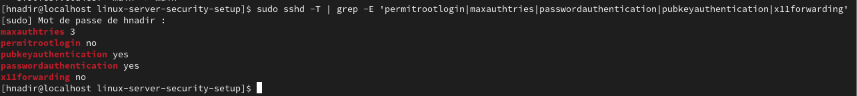
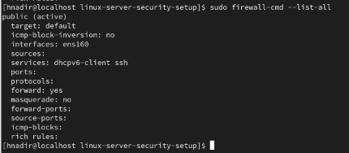
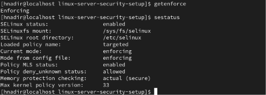
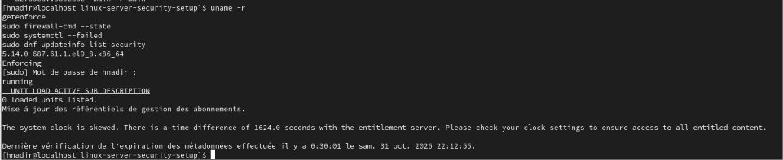

# Linux Server Hardening – Red Hat Enterprise Linux 9


## Project Overview

This project focuses on securing and hardening a Red Hat Enterprise Linux 9 environment running on VMware Workstation.

The objective was to improve the system's security posture by auditing configurations, strengthening access controls, securing SSH, managing firewall rules, reviewing SELinux policies, reducing unnecessary services, and applying security updates.

The project was conducted in a controlled virtual lab environment for educational purposes.

## Environment & Technologies

| Component | Technology |
|---|---|
| Operating System | Red Hat Enterprise Linux 9 |
| Virtualization | VMware Workstation |
| Firewall | firewalld |
| Access Control | SELinux |
| Remote Access | OpenSSH |
| Package Management | DNF |
| Version Control | Git & GitHub |
| Documentation | Markdown |

## Security Measures Implemented

### 1. Initial Security Audit
- Identified the operating system and system configuration.
- Checked the status of essential security services.
- Reviewed the initial firewall and SELinux configuration.
- Created a protected initial system backup.

### 2. User & Privilege Management
- Reviewed user accounts and administrative privileges.
- Configured the administrative user with `sudo` access through the `wheel` group.
- Validated sudoers configuration.
- Applied the principle of least privilege.

### 3. SSH Hardening
- Disabled direct root login over SSH.
- Reduced maximum authentication attempts to 3.
- Disabled X11 forwarding.
- Kept password authentication enabled because SSH key access had not yet been configured and tested.

### 4. Firewall Hardening
- Audited the active firewalld zone.
- Removed the unnecessary Cockpit service from the public zone.
- Verified permanent and runtime firewall configurations.
- Retained the required SSH service.

### 5. SELinux Verification
- Confirmed SELinux is enabled and running in Enforcing mode.
- Reviewed custom SELinux booleans.
- Checked SSH security contexts.
- Reviewed recent SELinux AVC audit events.

### 6. Service & Permission Hardening
- Reviewed sensitive system file permissions.
- Disabled unnecessary services:
  - Avahi
  - CUPS
  - Bluetooth
  - ModemManager
  - libstoragemgmt
- Verified that essential services remained operational.
- Checked listening network ports.

### 7. Security Updates & Final Audit
- Reviewed available security advisories.
- Applied available security updates using DNF.
- Rebooted the system to activate the updated kernel.
- Verified the firewall, SELinux and system service status.
- Confirmed that no failed systemd units remained during the final audit.

## Project Screenshots

The following screenshots provide evidence of the implemented security configurations.

### 1. Initial System Audit


### 2. SSH Hardening


### 3. Firewall Configuration


### 4. SELinux Enforcement


### 5. Final Security Audit


## Project Structure

```text
linux-server-security-setup/
│
├── configs/
├── docs/
│   ├── firewall-hardening.md
│   ├── selinux-hardening.md
│   ├── service-hardening.md
│   ├── ssh-hardening.md
│   ├── update-and-final-audit.md
│   └── user-management.md
│
├── logs/
├── scripts/
├── screenshots/
│   ├── 01-system-audit.png
│   ├── 02-ssh-hardening.png
│   ├── 03-firewall.png
│   ├── 04-selinux.png
│   └── 05-final-audit.png
│
├── .gitignore
└── README.md
```

## Skills Demonstrated

- Linux System Administration
- Linux Server Hardening
- SSH Security Configuration
- Firewall Management
- SELinux Security
- User & Privilege Management
- System Auditing
- Security Patch Management
- Git & GitHub
- Technical Documentation

## Future Improvements

- Configure and test SSH key-based authentication.
- Disable SSH password authentication after validating key-based access.
- Develop automated security audit scripts.
- Implement centralized log monitoring.
- Explore intrusion detection and security monitoring tools.

## Disclaimer

This project was developed in a virtual lab environment for educational purposes.

Security configurations should always be tested and validated before deployment in production environments.

---

**Author:** Hiba Nadir  
**Focus:** Cybersecurity & Linux System Administration  
**Platform:** Red Hat Enterprise Linux 9
